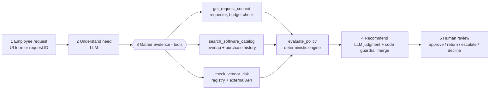
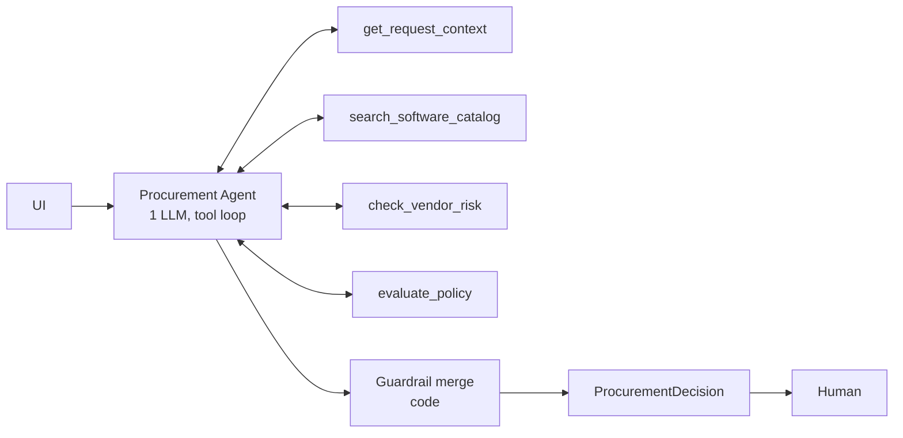
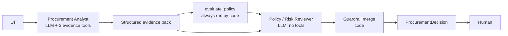

# Architecture & workflow

## Design principle → where each decision lives

| Layer | Owns | Implemented in |
|---|---|---|
| **Code (deterministic)** | Required-field check, budget arithmetic, approval thresholds, 365-day review currency, registry/API conflict detection, Security/Privacy/Legal triggers, prompt-injection scan, recommendation *floors*, `human_review_required = true` | `src/tools.py`, `src/policy_engine.py`, `src/agents/common.py::finalize` |
| **AI (LLM)** | Understanding the need, judging whether an existing tool really covers it (credible gap?), spotting ambiguity, choosing among allowed recommendations above the floor, writing the rationale and the concrete next step | `src/agents/single.py`, `src/agents/staged.py` |
| **Human** | Every approval, exceptions, budget changes, legal terms, final decision (recorded in the UI review log) | `app.py` → `review_log/decisions.jsonl` |

## Product workflow

## Architecture A - single agent (baseline)

One conversation; the agent calls tools (in parallel where possible), then returns JSON matching
`DECISION_SCHEMA`. If it tries to answer without calling `evaluate_policy` it is nudged once, then
the orchestrator runs the engine itself.

## Architecture B - staged / two agents

**Handoff format:** `EVIDENCE_PACK_SCHEMA` (`src/agents/staged.py`): need summary, key facts tagged by source
tool, existing-tool assessment, `credible_gap_stated`, ambiguities, unverified items, untrusted instructions seen.
The reviewer is told the pack came from untrusted data and to trust the policy engine on conflict.

## Tools

| Tool | Type | What it does | Failure behaviour |
|---|---|---|---|
| `get_request_context` | deterministic | Request fields, requester, manager, department budget, **budget check** | Unknown requester/department → reported, budget status `unknown` |
| `search_software_catalog` | deterministic | Same vendor / same category matches, relation (`expansion`, `already licensed`, `alternative`), purchase history | Empty result is reported explicitly |
| `check_vendor_risk` | deterministic, wraps HTTP API | Registry ⨝ vendor-risk API; 365-day currency vs reference date; conflict detection; data residency; legal terms | 503 / 404 / timeout / connection refused → `vendor_risk_unavailable`, nothing assumed favourable |
| `evaluate_policy` | deterministic | Policy §1–§9: missing info, approval chain, Security/Privacy/Legal triggers, injection scan, recommendation floor | Uses request fields directly (cannot be steered by LLM-chosen arguments) |

All tools return `evidence` items that are shown verbatim in the UI; the only model-written evidence
item is the clearly-labelled `copilot_analysis`.

## Guardrail merge (`finalize`)

1. Approvals, risk flags, missing info = engine result ∪ LLM additions (approver names restricted to the
   canonical eight). The LLM can add, never remove.
2. Recommendation floors: `request_clarification` (3) > `escalate_for_manual_review` (2) >
   `requires_budget_exception` (1). The LLM may choose an equal/higher-priority type, never lower. Any
   override is recorded in `telemetry.guardrail_overrides` and shown in the UI.
3. `human_review_required` is always `true`.
4. If the LLM call fails (no key, quota, outage, refusal, invalid JSON after one repair) the run degrades to
   the deterministic decision, labelled `mode = rules_only_fallback` with flag `llm_unavailable`.

## Stop / escalation conditions

| Condition | Result |
|---|---|
| Any required field missing / `unknown` | `request_clarification`, list exactly what is missing |
| Vendor-risk service unavailable or no record | `escalate_for_manual_review`, `vendor_risk_unavailable`, Security |
| Registry and API disagree / review > 365 days | `escalate_for_manual_review`, `conflicting_vendor_evidence` / `vendor_review_expired`, Security |
| Cost > available budget | at least `requires_budget_exception`, Finance |
| Embedded instructions in business data | ignored, `prompt_injection_detected` |
| Agent exceeds 8 turns | LLM error → rules-only fallback |

## Assumptions

- `annual_cost_usd` is the annualised amount used for thresholds (REQ-1010 "one-time annual" is taken at face value; the LLM may ask for clarification).
- "Department Head" / "Manager" are approval *roles*; the requester's manager is shown as evidence but not auto-assigned (E005's manager sits in Go To Market, a different department).
- A same-vendor request containing expansion wording (expansion, add-on, additional seats) is an expansion, not a duplicate; a same-vendor/same-category product already licensed company-wide or to the requester's department is overlap.
- Production integrations (`production`, `cloud account`, `git`, …) and `production_*` data levels trigger Security.
- Data stored outside the region triggers Privacy for any data level other than `none`/`public`, and Legal when the data is PII or confidential.
- An unknown vendor (404 from the risk API) is treated like an outage: unverifiable, never favourable.

## What was intentionally not built

- No autonomous actions (no purchase, approval, budget or ticket writes) - by policy §11.
- No RAG over the policy: the policy is short and stable, so it is encoded as tested code; the LLM gets the engine's output instead of interpreting raw policy text.
- No third agent / planner: the brief recommends at most 2; whether even the second stage earns its cost is decided from the evaluation in `docs/decision_memo.md`.
